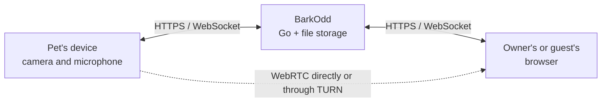

<div align="center">

# 🐾 BarkOdd

**English** · [Русский](README.ru.md)

**Stay close to your pet, even when you're away from home.**

Cameras, live sound and photos of noisy moments — in your browser, on your own server.

[Quick start](#quick-start) · [Configuration](#configuration) · [Make commands](#make-commands) · [Guide (Russian)](docs/guide.md)

</div>

---

BarkOdd turns a laptop, phone or tablet into a home camera. Open a room on the device staying with your pet, start monitoring and check in from another device. No mobile app or separate frontend build is needed: the web interface is embedded in a single Go binary.

The interface is available in English and Russian. English is the default; use **EN / RU** at the top of the page to switch languages. Your choice is saved in this browser.

## Features

| | What BarkOdd can do |
|---|---|
| 📹 Cameras | Multiple rooms and cameras, device selection and switching between camera views. |
| 🔊 Live sound | Each viewer can turn video and sound on independently. |
| 🐕 Events | Sound detection, photos and history for each camera. |
| 👥 Sharing | Multiple room owners and a guest QR link for each camera. |
| 🔐 Sign-in modes | A shared dashboard without sign-in, code-based access or user accounts. |
| 🏠 Your server | Local file storage, Go or Docker, WebSocket or WebRTC. |

> BarkOdd detects loud sounds, not barking specifically. Video and audio are not recorded; events and photos are saved. Monitoring requires the camera page to stay open and the device to stay awake.

## Quick start

Run all commands from the repository root. macOS and Linux are supported; use WSL2 on Windows.

### With Go installed

You need **Go 1.23+**, **Make**, **Bash** and **OpenSSL**. Node.js is not needed to run the app.

```sh
make run
```

This prepares `.env`, generates a sign-in code, builds the app and starts it at **http://127.0.0.1:8080**. Get the code in another terminal:

```sh
make admin-code
```

Sign in, create a room and choose **“Pet device”**. Allow access to the camera and microphone, then start monitoring. Press `Ctrl+C` to stop the server.

### With Docker

You need **Docker with a running daemon**, **Compose 2.20+**, **Make**, **Bash** and **OpenSSL**. Go does not need to be installed on your computer.

```sh
make docker-up
make admin-code
```

Open **http://127.0.0.1:8080**. The container runs in the background; the command waits until the app is ready.

```sh
make docker-logs  # View logs; Ctrl+C only stops following the logs
make docker-down # Stop containers and keep your data
```

> **Your phone needs an HTTPS address.** `127.0.0.1` and `localhost` are only accessible on the device running the server. To use a camera on another device or check in from outside your home, set up [public HTTPS or an existing proxy (Russian)](docs/running.md#размещение-с-https). Plain HTTP over a local network IP does not replace HTTPS for browser camera access.

## Configuration

### Sign-in

```sh
make run-demo   # Shared dashboard without sign-in; local access only by default
make run-admin  # Sign in with a generated code
make run-multi  # User registration and shared rooms
```

`make run` reads the mode from `.env`; the initial setup uses `admin_code`. Docker uses the same setting:

```sh
make docker-up AUTH_MODE=multi_user
```

Local sign-in modes use **separate data stores**. Switching to `multi_user` does not prevent you from returning to the demo. Native runs and local Docker runs also use separate storage. See [data locations (Russian)](docs/running.md#данные-и-переключение-режимов).

### Video and sound

| Transport | When to choose it |
|---|---|
| `websocket` — default | A simple setup: video and sound pass through the server; HTTPS/WSS is enough. |
| `webrtc` | A direct media connection between browsers, or through TURN. A separate TURN server may be needed across different networks. |

```sh
make run-multi MEDIA_TRANSPORT=webrtc
make docker-up AUTH_MODE=multi_user MEDIA_TRANSPORT=webrtc
```

Changing the transport does not change the data store for the selected sign-in mode. Stop the previous instance before switching configurations. For a comparison on one computer, you can add `STUN_URLS=none`. [STUN/TURN setup (Russian) →](docs/guide.md#stunturn-для-webrtc)

### Port and settings file

```sh
make run PORT=8090
make run ENV_FILE=.env.local
make docker-up PORT=8090
make docker-up DEPLOY=public ENV_FILE=.env.production
```

On the first run, a missing `ENV_FILE` is created automatically. Existing files and sign-in codes are preserved. Command-line settings take precedence over `.env`; see the [running guide (Russian)](docs/running.md) for the full rules and the special handling of `PUBLIC_URL`.

## Make commands

Run `make` or `make help` to see the available commands.

| Command | Purpose |
|---|---|
| `make init` | Create `.env` with a random code if the file does not exist. |
| `make run` | Build and run the app with local settings. |
| `make run-demo / run-admin / run-multi` | Run the selected sign-in mode. |
| `make admin-code` | Show the sign-in code from the current configuration. |
| `make build` | Build `bin/barkodd` with the embedded interface. |
| `make docker-up` | Build and start the containers, then wait for readiness. |
| `make docker-down` | Stop the containers while preserving volumes. |
| `make docker-logs / docker-ps` | View container logs or status. |
| `make docker-config` | Validate the Compose configuration without printing secrets. |
| `make test` | Run Go tests with the race detector and JavaScript unit tests. |
| `make vet` | Check Go code with `go vet`. |

For Docker commands, `DEPLOY=local|public|macmini` selects the configuration. Use the same `DEPLOY` and `ENV_FILE` when stopping containers or viewing logs as you did when starting them.

## How it works



In WebSocket mode, the server relays video and sound. In WebRTC mode, it handles access and connection signaling; media travels between browsers or through TURN. Events and photos are saved on the server in both modes.

## Documentation and development

- [Running the app, `.env`, Docker, HTTPS and troubleshooting (Russian)](docs/running.md)
- [Full guide: cameras, access, events, TURN, backups and browser tests (Russian)](docs/guide.md)
- [Project architecture (Russian)](docs/design.md)
- [Example environment variables](.env.example)

Server code is in `cmd/barkodd/` and `internal/server/`, the interface is in `web/`, and browser tests are in `tests/`.

```sh
make build
make test  # Go 1.23+, a C toolchain for the race detector, Node.js 20+ and npm
make vet
```

Node.js is only needed for development checks. Browser tests require a separate test server and Playwright: see the [test instructions (Russian)](docs/guide.md#проверки-разработки).
