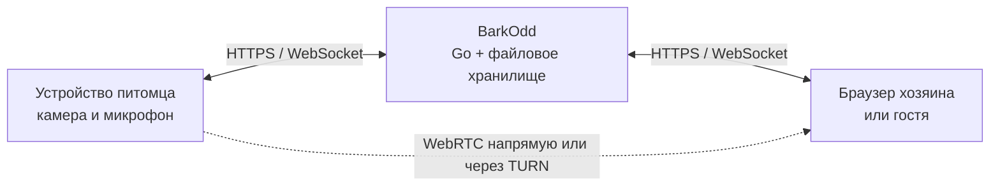

<div align="center">

# 🐾 BarkOdd

[English](README.md) · **Русский**

**Будьте рядом с питомцем, даже когда вас нет дома.**

Камеры, живой звук и фотографии шумных моментов — в браузере, на вашем сервере.

[Быстрый старт](#быстрый-старт) · [Конфигурации](#конфигурации) · [Команды Make](#команды-make) · [Руководство](docs/guide.md)

</div>

---

BarkOdd превращает ноутбук, телефон или планшет в домашнюю камеру. Откройте комнату на устройстве питомца, включите наблюдение и смотрите с другого устройства. Мобильное приложение и отдельная сборка интерфейса не нужны: веб-интерфейс встроен в один Go-бинарник.

Интерфейс доступен на английском и русском. По умолчанию выбран английский; переключатель **EN / RU** вверху страницы сохраняет выбор в этом браузере.

## Возможности

| | Что умеет BarkOdd |
|---|---|
| 📹 Камеры | Несколько комнат и камер, выбор устройства и переключение просмотра. |
| 🔊 Живой звук | Видео и звук включаются независимо для каждого зрителя. |
| 🐕 События | Обнаружение шума, фотографии и история по каждой камере. |
| 👥 Общий доступ | Несколько хозяев комнаты и гостевая QR-ссылка на отдельную камеру. |
| 🔐 Режимы входа | Общий кабинет без входа, вход по коду или пользовательские аккаунты. |
| 🏠 Свой сервер | Локальное файловое хранилище, Go или Docker, WebSocket или WebRTC. |

> Обнаруживается громкий звук, а не именно лай. Видео и звук не записываются; сохраняются события и фотографии. Для работы наблюдения страница камеры должна оставаться открытой, а устройство — бодрствовать.

## Быстрый старт

Все команды выполняются из корня репозитория. Поддерживаются macOS и Linux; в Windows используйте WSL2.

### С установленным Go

Нужны **Go 1.23+**, **Make**, **Bash** и **OpenSSL**. Node.js для запуска приложения не нужен.

```sh
make run
```

Команда подготовит `.env`, сгенерирует код входа, соберёт приложение и запустит его на **http://127.0.0.1:8080**. В другом терминале получите код:

```sh
make admin-code
```

Войдите, создайте комнату и выберите **«Устройство питомца»**. Разрешите доступ к камере и микрофону и включите наблюдение. Остановка сервера — `Ctrl+C`.

### Через Docker

Нужны **Docker с работающим daemon**, **Compose 2.20+**, **Make**, **Bash** и **OpenSSL**. Go на компьютере не требуется.

```sh
make docker-up
make admin-code
```

Откройте **http://127.0.0.1:8080**. Контейнер запускается в фоне; команда ждёт готовности приложения.

```sh
make docker-logs  # Логи; Ctrl+C завершает только просмотр
make docker-down # Остановка с сохранением данных
```

> **Для телефона нужен HTTPS-адрес.** `127.0.0.1` и `localhost` доступны только на том устройстве, где запущен сервер. Для камеры на другом устройстве и просмотра вне дома настройте [публичный HTTPS или существующий прокси](docs/running.md#размещение-с-https). Обычный HTTP по IP в локальной сети не заменяет HTTPS для доступа браузера к камере.

## Конфигурации

### Вход

```sh
make run-demo   # Общий кабинет без входа, только локально по умолчанию
make run-admin  # Вход по сгенерированному коду
make run-multi  # Регистрация пользователей и общие комнаты
```

`make run` берёт режим из `.env`; после первой настройки это `admin_code`. Для Docker режим задаётся тем же параметром:

```sh
make docker-up AUTH_MODE=multi_user
```

Локальные режимы входа используют **раздельные данные**. Переключение в `multi_user` не мешает вернуться к демо. Нативное приложение и локальный Docker также имеют отдельные хранилища. Подробнее — [где лежат данные](docs/running.md#данные-и-переключение-режимов).

### Видео и звук

| Транспорт | Когда выбирать |
|---|---|
| `websocket` — по умолчанию | Простой запуск: видео и звук проходят через сервер, достаточно HTTPS/WSS. |
| `webrtc` | Прямой медиаканал между браузерами или через TURN. Для разных сетей может потребоваться отдельный TURN-сервер. |

```sh
make run-multi MEDIA_TRANSPORT=webrtc
make docker-up AUTH_MODE=multi_user MEDIA_TRANSPORT=webrtc
```

Транспорт не меняет хранилище выбранного режима входа. Остановите предыдущий экземпляр перед сменой конфигурации. Для сравнения на одном компьютере можно добавить `STUN_URLS=none`. [Настройка STUN/TURN →](docs/guide.md#stunturn-для-webrtc)

### Порт и файл настроек

```sh
make run PORT=8090
make run ENV_FILE=.env.local
make docker-up PORT=8090
make docker-up DEPLOY=public ENV_FILE=.env.production
```

При первом запуске отсутствующий файл `ENV_FILE` создаётся автоматически. Существующий файл и код входа сохраняются. Параметры командной строки имеют приоритет над `.env`; подробные правила и особенность `PUBLIC_URL` описаны в [инструкции запуска](docs/running.md).

## Команды Make

`make` или `make help` показывают доступные команды.

| Команда | Назначение |
|---|---|
| `make init` | Создать `.env` со случайным кодом, если файла ещё нет. |
| `make run` | Собрать и запустить приложение с локальными настройками. |
| `make run-demo / run-admin / run-multi` | Запустить выбранный режим входа. |
| `make admin-code` | Показать код входа из текущей конфигурации. |
| `make build` | Собрать бинарник `bin/barkodd` со встроенным интерфейсом. |
| `make docker-up` | Собрать и запустить контейнеры, дождаться готовности. |
| `make docker-down` | Остановить контейнеры, сохранив volumes. |
| `make docker-logs / docker-ps` | Посмотреть логи или состояние контейнеров. |
| `make docker-config` | Проверить Compose-конфигурацию без вывода секретов. |
| `make test` | Запустить Go-тесты с race detector и модульные JS-тесты. |
| `make vet` | Проверить Go-код через `go vet`. |

У Docker-команд параметр `DEPLOY=local|public|macmini` выбирает конфигурацию. Для остановки и просмотра логов используйте тот же `DEPLOY` и `ENV_FILE`, что при запуске.

## Как это работает



В режиме WebSocket сервер передаёт видео и звук. В WebRTC он обслуживает доступ и согласование соединения; медиаданные идут между браузерами либо через TURN. События и фотографии сохраняются на сервере в обоих режимах.

## Документация и разработка

- [Запуск, `.env`, Docker, HTTPS и устранение ошибок](docs/running.md)
- [Полное руководство: камеры, доступ, события, TURN, резервные копии и браузерные тесты](docs/guide.md)
- [Архитектура проекта](docs/design.md)
- [Пример переменных окружения](.env.example)

Исходники сервера находятся в `cmd/barkodd/` и `internal/server/`, интерфейс — в `web/`, браузерные тесты — в `tests/`.

```sh
make build
make test  # Go 1.23+, C toolchain для race detector, Node.js 20+ и npm
make vet
```

Node.js нужен только для проверок разработки. Браузерные тесты требуют отдельного тестового сервера и Playwright: [порядок запуска](docs/guide.md#проверки-разработки).
